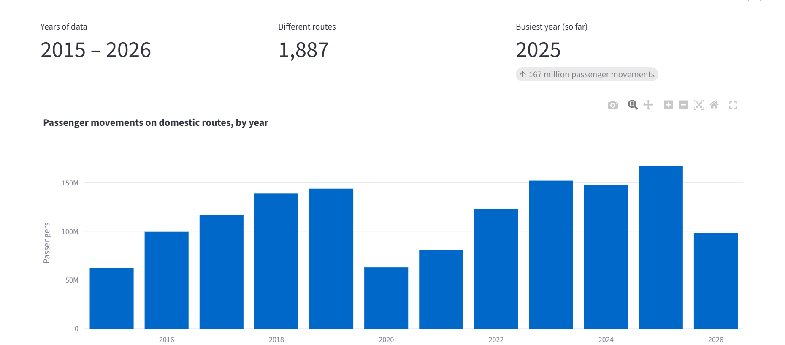
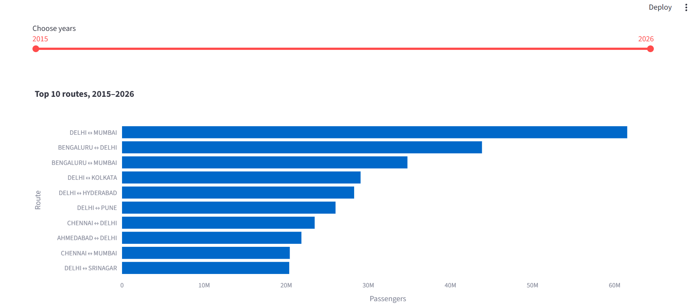
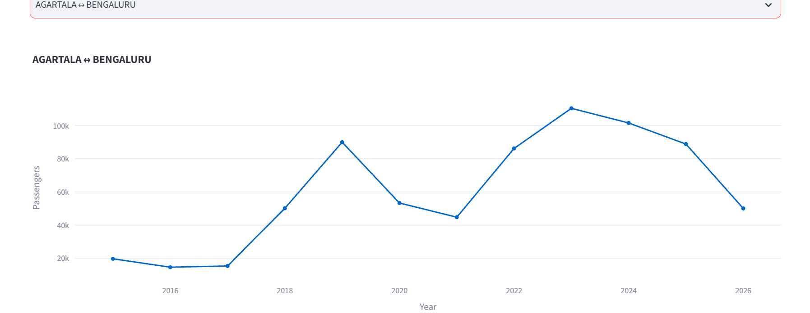
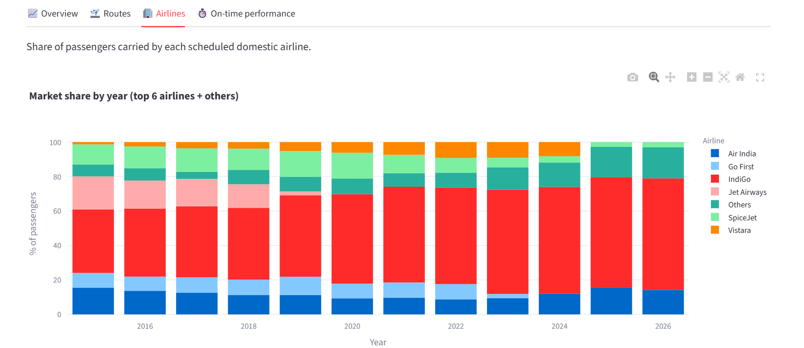
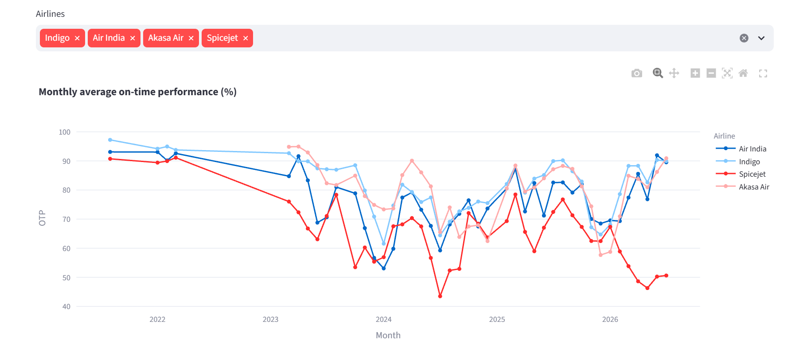

# AeroPulse: Indian Aviation Analytics

   
   
   
   
   

An interactive dashboard that explores Indian domestic aviation: passenger
traffic by route, airline market share, and on-time performance.

Built with Python, Pandas, SQL (SQLite) and Streamlit + Plotly.

## Questions explored

- How did domestic passenger traffic change over time, including the COVID-19 drop and recovery?
- Which routes carry the most passengers?
- How has airline market share changed?
- How does on-time performance compare between airlines?

## Data

DGCA and Ministry of Civil Aviation (India), collected by
[Vonter/india-aviation-traffic](https://github.com/Vonter/india-aviation-traffic)
and licensed under the [Open Database License (ODbL)](http://opendatacommons.org/licenses/odbl/1.0/).
Please attribute DGCA and the Ministry of Civil Aviation. If you publish an adapted
version of the database, the ODbL share-alike condition applies.

Files used: `aggregated/domestic/city.csv`, `aggregated/domestic/carrier.csv`, `aggregated/daily.csv`.

## How to run

```bash
python -m venv .venv
# Windows:  .venv\Scripts\activate      Mac/Linux:  source .venv/bin/activate
python -m pip install -r requirements.txt
python -m streamlit run app.py
```

The data files are already in the `data/` folder. To refresh them from the source, run `python download_data.py` first.


## Data cleaning

- Removed exact duplicate rows and rows missing dates, cities or passenger numbers.
- Standardised city names (trimmed spaces, upper case).
- Merged `A-B` and `B-A` into one route, and added passengers in both directions.
- Removed the "Total Domestic/International" summary rows from the airline file
  so totals were not counted as an airline.
- On-time values were stored as text (e.g. `"94.4%"`); converted them to numbers.

## Findings

All numbers come from `python findings.py` on the included data (2015 to July 2026).

1. **COVID-19 cut domestic passenger movements by 56.3%** between 2019 (143.7 million) and 2020 (62.9 million).
2. **Traffic fully recovered:** 2025 reached 166.9 million, about 16.1% above 2019.
3. **Delhi to Mumbai is the busiest route**, with about 61.5 million passenger movements over the period, ahead of Bengaluru to Delhi (43.8 million).
4. **IndiGo's market share grew from 47.2% (2019) to 64.1% (2025)** among scheduled domestic airlines, as SpiceJet, Go First and Jet Airways lost ground or stopped flying.
5. **Demand is seasonal:** December is the busiest month (9.2% of all traffic) while May and September are the quietest (7.5% and 7.6%).

## Limitations

- Traffic figures are monthly totals per route, not individual flights or people.
- The current year is incomplete, and 2015 starts mid-year.
- On-time data comes from daily Ministry reports that have gaps, and only covers
  mid-2021 onward. Monthly values are simple averages of reported days.
- Airlines that merged or closed (Vistara, AirAsia India, GoAir) stop appearing in later data.

## Future improvements

- Add airport-level analysis.
- Add data-quality tests.
- Deploy publicly on Streamlit Community Cloud.
